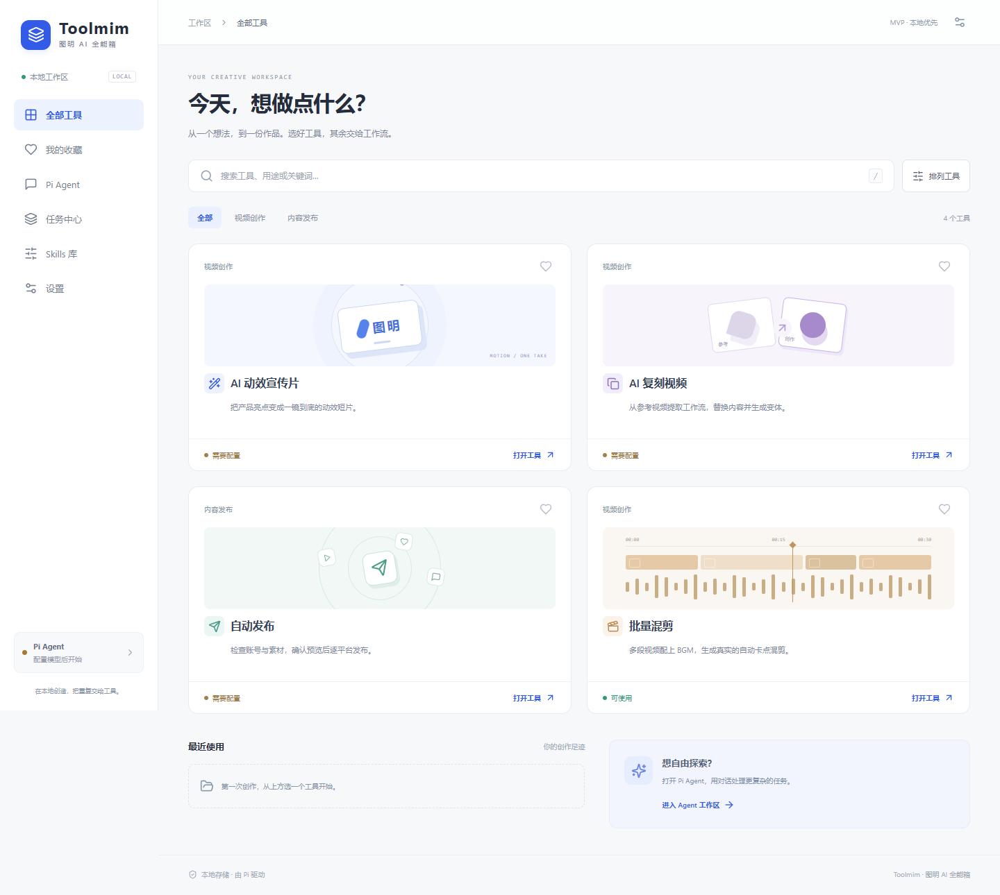
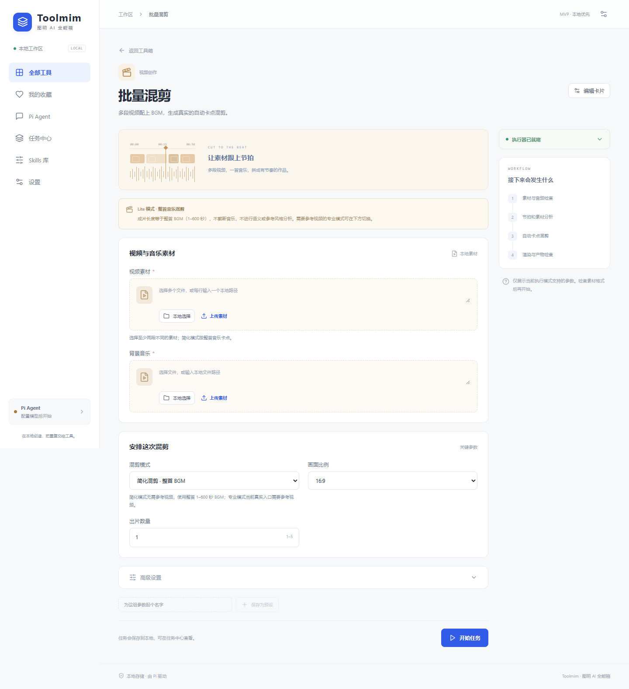
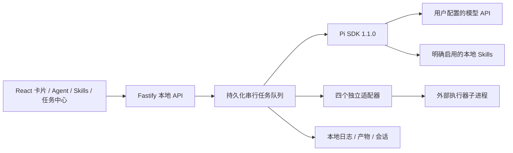

<div align="center">

# Toolmim

**图明 AI 全能箱**

基于 Pi Agent 的本地优先、Skills 功能卡片式 AI Agent 工具箱。

[](LICENSE) [](package.json) [](docs/verification.md)

Local-first Pi Agent toolbox with Skills-powered task cards.

</div>



Toolmim 把本地 Skills 与独立执行器组织成可操作的功能卡片：填写参数、查看真实任务阶段与日志、预览产物；也可进入 Agent 工作区，让 Pi 使用已启用 Skills 与本地文件。

当前是 **Windows 优先的可运行 MVP**。四张卡片的上游接通程度不同，详见下表。仓库不包含第三方引擎、账号、API Key、用户素材或生成视频。

## 核心特点与已实现功能

- 卡片工作台：四个专用输入界面，支持搜索、分类、收藏、排序、最近使用、条件字段、本地预设和 Manifest 编辑。
- 真实 Pi 运行时：流式对话、工具事件、文件读写、Skill 加载、JSONL 会话保存与恢复、停止执行。
- 本地任务系统：串行队列、阶段日志、人工确认、取消、重试、重启中断识别、按任务登记产物。
- Skills 管理：扫描、导入、启停、重扫本地 `SKILL.md`，执行时只加载明确启用的资源。
- 素材与产物：文件上传、Windows 原生选择器接口、视频/音频/图片预览、打开产物目录接口。
- 本地配置：模型和独立执行器设置；项目 API Key 使用 Windows 当前用户 DPAPI 加密存储。

服务仅监听 `127.0.0.1`。本地优先指配置、会话与任务数据保存在本机；模型推理使用你配置的供应商，消息和所选上下文会发送到该供应商。

## 四个内置功能卡片

| 卡片 | 对应项目 | 当前接通状态 | 实际验证范围 |
| --- | --- | --- | --- |
| AI 动效宣传片 | [onetake](https://github.com/feitangyuan/onetake) | 三方案选择、Pi 创作、探测/渲染/验收适配已编写 | 真实 Python 入口、模块与 Chromium 启动通过；**未完成真实模型驱动的成片流程** |
| AI 复刻视频 | [Hypit](https://github.com/hypit-ai/hypit) | 工作流生成与 `check` / `plan` 适配，停在计划阶段 | 官方接口核对、缺安装诊断；**Build、后台取消与导出尚未接通** |
| 自动发布 | [social-auto-upload](https://github.com/dreammis/social-auto-upload) | 逐平台检查、预览、严格布尔确认与 CLI 调用 | 测试替身验证发布门禁；**未使用真实账号或向平台上传** |
| 批量混剪 | [BGM Montage](https://github.com/sharbvane/bgm-montage) / [BMTS Lite](https://github.com/sharbvane/BMTS-Lite) | 默认 Lite：多视频 + 整首 BGM；专业模式另需参考与模型 | **Lite 真实官方引擎成片、完整解码、源文件哈希检查通过**；专业模式完整渲染未验证 |



卡片存在不等于执行器已安装。缺模型、依赖或账号时显示诊断，不产生模拟成功。Lite 不包含语义选片、参考风格学习或 Agent 视觉审片。详细入口、参数与限制见 [适配器能力说明](docs/capabilities.md)。

## 安装与启动

主要支持 **Windows 10/11、Node.js ≥22.19、npm、Git**。当前模型密钥保存依赖 Windows DPAPI，原生选择器仅支持 Windows；macOS/Linux 尚未完成整套验证。

```powershell
git clone https://github.com/sharbvane/Toolmim.git
cd Toolmim
npm ci --ignore-scripts
npm run build
npm start
```

打开 [http://127.0.0.1:4317](http://127.0.0.1:4317)。终端按 Ctrl+C 停止服务。Windows 也可双击 `start-toolbox.cmd`，脚本会安装缺失依赖、构建、启动并打开页面。

开发模式：`npm run dev`，前端与 API 共用同一端口。可用环境变量 `TOOLMIM_PORT` 指定端口、`TOOLMIM_DATA` 指定数据目录；兼容旧的 `TUMING_PORT` / `TUMING_DATA`。便捷脚本使用默认端口。应用不自动读取 `.env`，密钥通过设置页输入。

仅运行工具箱不需要 Python 或 FFmpeg。运行视频执行器时，按上游说明准备独立环境、FFmpeg/ffprobe、浏览器及所需模型；在设置页填入安装根目录和命令路径。Toolmim 不复制引擎，也不代替上游安装流程。

## 模型 API 配置

1. 打开“设置”，选择 Provider 和模型，输入**本项目专用** API Key 并保存。
2. 使用兼容服务时填写 Base URL，例如 `https://api.example.com/v1`，及该服务支持的模型 ID。首版自定义端点使用 OpenAI Chat Completions 文本协议，不保证任意供应商兼容。
3. 点击“创建连接测试”：实际 Pi 会读取一个本地检查文件并返回结果。配置就绪只表示字段已填好，网络成功以任务结果为准。

密钥存于 `.data/credentials.dpapi`，不回传浏览器或写入明文状态。Toolmim 不读取个人 Pi/Codex 登录数据，也不回退到环境中的模型密钥。加密文件绑定 Windows 用户，不应作为跨机配置分发。

默认 Agent 只读写工作目录、读取已启用 Skill 资源，并拒绝凭据及目录逃逸。**“允许执行本地命令”默认关闭；开启后命令拥有当前用户权限，工作目录不是 OS 沙箱。** 只对可信 Skills 开启，不要将本地服务代理到公网。

## Skills 导入与功能卡片机制

Skills 库扫描当前用户的 `.codex/skills` 和 `.agents/skills`。也可输入本地 Skill 目录或 `SKILL.md` 路径导入，检查后启用并重扫。内置卡片关联 Skill 首次发现时自动启用；其他导入项默认关闭，可在库中调整。

Skill 是 Agent 指令与资源；卡片是用户输入与执行流程。`server/cards.ts` 定义 Manifest、字段 Schema 与工作流；`server/adapters.ts` 将参数映射到真实 Pi 步骤或上游入口。Manifest 可调整现有卡片；**导入任意 Skill 不会自动生成新的可执行适配器**。

onetake/Hypit 须同时准备并启用对应 Skill、模型和执行器。Lite 混剪无需模型认证：选两个或更多视频、整首 BGM、画幅和份数后创建任务。第三方许可证继续适用，见 [第三方说明](THIRD_PARTY.md)。

设置字段的无凭据示例见 [executor-settings.example.json](docs/executor-settings.example.json)，占位目录须在设置页替换，应用不会自动载入此文件。

## Pi Agent 技术架构



Pi 管理模型请求、工具循环、事件与会话；Toolmim 管理权限、输入、队列、确认与产物。默认不加载个人扩展代码或隐式模型认证，详见 [Pi 运行时说明](docs/pi-runtime.md)。

## 项目目录

```text
src/                     React 界面与样式
shared/types.ts          卡片、任务、设置等共享类型
server/
  index.ts               API、文件与本地访问边界
  pi-runtime.ts          真实 Pi SDK、工具与会话
  cards.ts               卡片 Schema 与工作流
  adapters.ts            四个上游执行器适配
  bmts-lite-runner.py     独立 BMTS Lite 薄桥接
  task-manager.ts        队列、确认、取消、重试、产物
  store.ts / security.ts 本地状态与 DPAPI 凭据
 tests/                  单元、API、SDK、浏览器测试
 docs/                   架构、能力、验证记录、公开截图
 start-toolbox.cmd       Windows 一键启动
 .data/                  运行时生成，Git 忽略
```

## 测试与开发状态

```powershell
npm test
npm run build
# 未安装 Chrome 或 Playwright 浏览器时先执行：
npx playwright install chromium
npm run test:e2e
npm audit
```

E2E 使用独立端口 4320 和 `test-results/app-data`。Windows 优先使用标准位置的 Chrome，也可设置 `PLAYWRIGHT_CHROMIUM_EXECUTABLE_PATH`；否则使用 Playwright Chromium。

完整测试还要求 `python` 与 `ffmpeg` 在 PATH 中：发布门禁测试以它们运行明确的 CLI 替身并生成测试片段，不调用真实平台。

2026-10-11 已验证：24 项单元/集成测试、5 项真实浏览器 E2E、生产构建、npm audit（0 个已知漏洞）。SDK 测试使用**本地受控模型协议 fixture**，发布测试使用**明确的 CLI 替身**；它们不代表外部模型或平台发布。实际 Lite 渲染另行验证，媒体与本机证据不公开。全新克隆流程与公开提交检查见 [验证记录](docs/verification.md)。

已知限制：串行任务；无多 Agent 编排、桌面封装或 OS 命令沙箱；外部模型未认证验证；onetake 全链路、Hypit 成片导出、真实社交发布、专业参考混剪未完成实机验证。原生选择器与资源管理器打开接口已实现，但未完成交互验收。

## 致谢与许可证

感谢 [Pi](https://github.com/earendil-works/pi)、[onetake](https://github.com/feitangyuan/onetake)、[Hypit](https://github.com/hypit-ai/hypit)、[social-auto-upload](https://github.com/dreammis/social-auto-upload)、[BGM Montage](https://github.com/sharbvane/bgm-montage)、[BMTS Lite](https://github.com/sharbvane/BMTS-Lite) 及前端、服务和测试依赖。

Toolmim 自身源码采用 [MIT License](LICENSE)。第三方分别保留 MIT、AGPL、PolyForm Noncommercial 或 Hypit 自定义条款，不统一重新授权为 MIT，也不将受限源码宣称为无条件开源。完整清单见 [THIRD_PARTY.md](THIRD_PARTY.md)。
